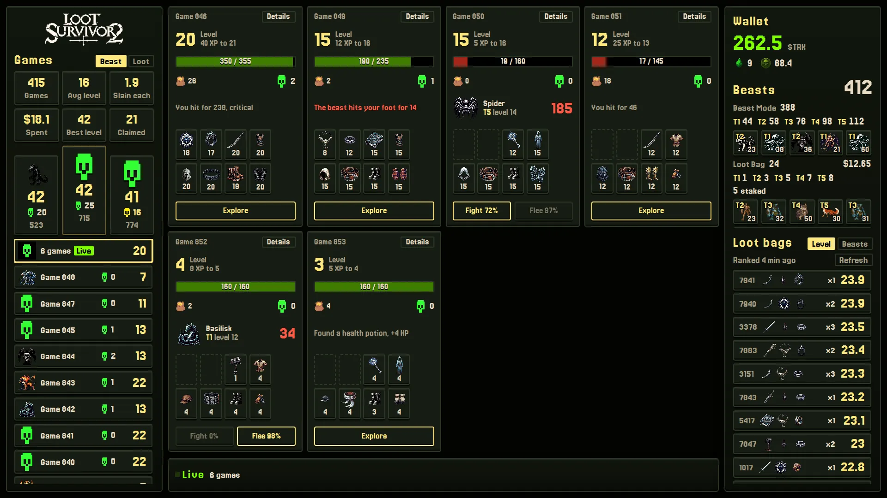

# ls-agent

A bot that plays [Loot Survivor 2](https://lootsurvivor.io), a dungeon game on the Starknet blockchain, day and night. It picks every move with fixed rules, pays for each move from its own wallet, and keeps the beasts it kills.

You watch it on a page that runs on your own machine: `npm start`, then open http://127.0.0.1:4100.



## What it does

```
      ┌───────────────────────────────────────────────────┐
      ▼                                                   │
  STRK ≥ 30 ? ──no──► wait 5 min, check again ────────────┤
      │ yes                                               │
      ▼                                                   │
  80 Beast Mode games                                     │
      │                                                   │
      ▼                                                   │
  the best loot bag costs ≤ 100 SURVIVOR                  │
  and the wallet has enough?                              │
      ├──yes──► buy it, play one Loot Dungeon game ───────┤
      └──no───► skip it ──────────────────────────────────┘
```

Several games run side by side, and their moves go out together, so they share the network fee.

## What it costs

Every move is a small payment in STRK, the network's token, so a long game costs more than a short one. The page shows what the games have cost so far. Most games end early, so expect many short games for each deep one.

The bot never spends its last 20 STRK. It waits once the wallet holds less than 30 STRK: the 20 it keeps, plus 10 of margin for the next moves. A Loot Dungeon game first buys a loot bag with SURVIVOR tokens, and the bot pays at most 100 for it.

## Results

As of 2026-11-22. `npm run stats` writes this section.

How the rules play on the local copy of the game, where games cost nothing:

| Dungeon | Games | Average level | Reach level 30 | Named beasts a game |
|---|---|---|---|---|
| Beast Mode | 10,000 | 16.2 | 8.7% | 2 |
| Loot Bag | 10,000 | 18.1 | 9.7% | 2.6 |

How the real games went:

| Dungeon | Games | Average level | Best level | Named beasts a game | Beasts claimed | Record game |
|---|---|---|---|---|---|---|
| Beast Mode | 477 | 15.8 | 42 | 1.8 | 25 | level 42, 25 named beasts |
| Loot Bag | 4 | 28.3 | 32 | 6 | 24 | level 32, 11 named beasts |

What the real games cost for their moves and loot bags, in dollars at today's prices:

| Dungeon | Spent | Per game | Per named beast killed |
|---|---|---|---|
| Beast Mode | 639 STRK ($20.2) | 1.3 STRK ($0.04) | $0.02 |
| Loot Bag | 16 STRK + 234 SURVIVOR ($10.9) | 4 STRK + 58.6 SURVIVOR ($2.72) | $0.45 |

## Run it yourself

You need Node 22.18 or newer and `npm install` before `npm start`. Practice games cost nothing. Playing for real needs a funded wallet, and [AGENTS.md](AGENTS.md) explains that and the rest.

MIT licence.
